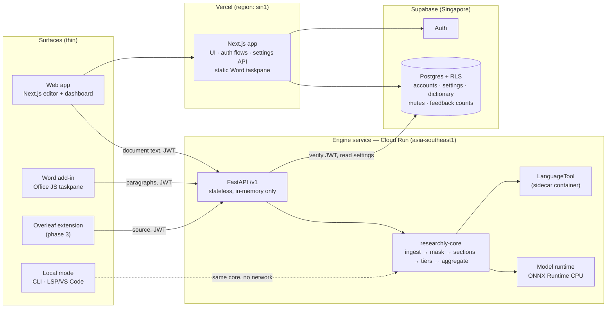

# Researchly — Production Architecture

| | |
|---|---|
| **Status** | v1.3 — owner decisions D1–D8 and product decisions P1–P5 recorded 2026-10-03; S0 built (PR #1) |
| **Date** | 2026-10-03 |
| **Owner** | Amriit (product owner, supervising) |
| **Author** | Claude, acting as lead engineer, with staff-engineer, ML-research and platform sub-agent reports |
| **Supersedes** | The local-only delivery model in `docs/roadmap-rewrite-and-desktop.md` |
| **Method** | *The Art of Building Software* ch. 22–27: purpose → compact specification → architecture proportional to the promise → trace one action → claims tied to evidence → one usable slice at a time |

This document answers four questions:

1. What Researchly is promising.
2. Which components keep that promise, and where each one runs.
3. Which decisions were made, and what each one costs.
4. What evidence will show it works.

It is a map, not a build log. The build history stays in `docs/PROJECT_LOG.md`.

Section 13 records the owner's decisions. Anything still open is marked **⟨OWNER⟩**.

---

## 1. Purpose — a moment in someone's day

> A third-year PhD student has a Discussion chapter due to their supervisor on
> Friday. The prose is grammatical but the chapter *doesn't land*. They can't
> say why. Their supervisor's feedback will arrive in three weeks.
> They open Researchly, drop in `chapter4.tex`, and within seconds see:
> the chapter never restates the gap it fills; two paragraphs make a causal
> claim from observational data; hedging collapses in the last third; and the
> limitations paragraph doesn't soften the claims it should. Each flag says
> *why*, cites *where the advice comes from*, and links to a short lesson.
> Nothing is rewritten for them. They fix it themselves — and learn the move.

**The promise.** Researchly is a writing *coach* for research students: a more intelligent Grammarly for scientific writing. It works on three levels:

- **Sentence** — correctness and clarity.
- **Paragraph** — flow, given→new order, topic sentences.
- **Document** — narrative, rhetorical moves, the claim–evidence chain, and hedging calibration.

It **advises; it never drafts**. Generative AI can now write for students. This product's value is the opposite: making the student a better writer.

**What it is not:**

- not a paraphraser or a text generator;
- not a plagiarism checker;
- not a reference manager;
- not a replacement for a supervisor.

### 1.1 What carries over unchanged from the prototype

These are the product's identity, and they move into production unchanged:

| Principle | Origin | Production consequence |
|---|---|---|
| Four-type taxonomy: Correction / Improvement / Convention / Preference | CLAUDE.md #3 | A field in the API contract. Conventions are never rendered as errors. Preferences are hidden by default. |
| Section-aware advice | CLAUDE.md #4 | Section detection is a first-class pipeline stage, not a rule detail. |
| Precision over recall | CLAUDE.md #5 | A noise-floor gate in CI (≤ 11 flags/1000 words on accepted theses). Learned models abstain below a calibrated threshold. |
| Every suggestion explainable | CLAUDE.md #6 | Every suggestion carries `why`, a named `source` and a `learn_ref`. If a model can't explain itself, a human-authored rule or question must. |
| No generative drafting | CLAUDE.md #1 | Learned components are **classifiers, taggers and scorers only**. See ADR-06. |
| No silent tier failure | CLAUDE.md "how to work" | Health status per tier is part of every API response and is shown in every surface. |

### 1.2 What changes

**Researchly becomes a hosted product (owner decision, 2026-10-03).** Until now, non-negotiable #2 read: "no document text ever leaves the machine". It is now **amended, not deleted**. ADR-02 sets out the replacement promise, which still has to satisfy publishers' confidentiality expectations.

### 1.3 Why Researchly, when students already have LLMs and Grammarly?

Every product decision has to keep this question answerable. The owner's framing (2026-10-03): Researchly is built for academic writing, from a professor's notes, communication courses and established best practice.

That origin is necessary but not enough. Anyone can paste a style guide into a chatbot. The defensible answer is the combination below, which LLMs and Grammarly *structurally* cannot offer:

| Researchly promise | Why an LLM can't make it | Why Grammarly doesn't |
|---|---|---|
| **Allowed to use.** It never writes or rewrites for you | Generating text is what it does. Many institutions restrict generative AI in theses and assessment | Its paid tiers include generative rewriting |
| **Confidential.** No AI model sees the manuscript (ADR-02, ADR-07) | Your text goes to the model provider | Text is processed in the cloud by a generalist service |
| **Sourced.** Every flag has a `why` and a named source (CLAUDE.md #6) | Feedback is plausible but unsourced, and sometimes invented | Explanations are generic |
| **Consistent.** The same text always gets the same feedback | A second run gives a different critique | Mostly yes, for its rule-based layer |
| **Section- and discipline-aware.** Passive voice is fine in Methods; reporting checklists apply | Only if prompted, and unreliably | Not section-aware |
| **Teaches.** Learn cards, and personal patterns over time | No memory of your growth; it fixes text instead of teaching | Optimises the text, not the writer |
| **Whole-document narrative.** Moves, argument chain and hedging across a 60k-word thesis | Context limits; it summarises rather than maps | Sentence-level only |

**Where we deliberately lose:** fluent rephrasing. Researchly does not compete on it (ADR-07).

**One-line positioning:** *the writing coach you're allowed to use — it cites its sources and makes you a better writer.*

Each row above is a claim, so each needs evidence (§11). That includes a comparison study, PLAN.md S6, run only on public CC-BY text.

### 1.4 How students use it (product decisions P1–P5, 2026-10-03)

- **P1: a coach beside the student's tools, not a place to write.**
  - The **web app is the revision studio**: whole-document review, the narrative map and the reviewer report. Small edits and a re-check are allowed, but it is not a word processor.
  - **Add-ins** (Word, Overleaf, and VS Code via the LSP) bring live feedback to wherever the student already writes.
  - A **Draft / Revise mode** switch sets how much appears at each stage:

    | Stage | Mode | What the student sees |
    |---|---|---|
    | Planning | — | What should this section do? |
    | Drafting | Draft | Sentence-level hints only |
    | Revising | Revise | Full narrative and argument review |
    | Pre-submission | Revise | Checklists |

- **P2: v1 includes**
  - **consistency checks**: abbreviations defined once, terminology, tense per section, numbers and units, figure and table citation;
  - **reporting-guideline checklists**: CONSORT, STROBE, PRISMA, EPIFORGE.
- **P3: discipline packs.**
  - A **communication core** applies to every discipline.
  - **Epidemiology / infectious-disease modelling** is the first pack; biomedical and others follow.
  - Domain checks cover what was *reported* (for example, convergence diagnostics for a Bayesian fit), never whether the science is *right*.
- **P4: figures, tables and equations get structural checks.**
  - Cross-references exist, are in order and come before first use.
  - Caption quality.
  - Equation symbols are defined.
  - Numbers in the text match the cited table.
  - Image understanding is out of scope under rule #1.
  - Input arrives as it is written: `.docx` with embedded figures and tables, or an Overleaf `.zip`. PDF is not a primary input.
- **P5: platforms.**
  - Responsive web, installable as a PWA, plus desktop add-ins.
  - Phones and tablets are for *reading* reports and lessons.
  - No native iOS or Android apps in v1.

---

## 2. Where we are starting from

These facts come from the staff-engineer audit of 2026-10-03. Each one shapes a decision below.

1. **There are three diverging copies of the code.** The tree CLAUDE.md calls canonical is the *oldest*.

   | Tree | Contents | Tests |
   |---|---|---|
   | `prototype/` | v0.8 through P18; 37 rules | 213 pass, 1 Linux-only failure |
   | `Researchly_Updated_14082026/` | Adds P19–P20: GEC scaffold, `argument.py` (Toulmin), 5-tab Word pane, shared settings, standalone installers | 260 pass |
   | `Experiment_Researchly/` | Adds P21-EXP: rhetorical-move classifier, drafting guide, exemplar retrieval | 275 pass |

   The root `docs/PROJECT_LOG.md` stops at P18.

2. **The engine contract is good and worth keeping.**
   - `api.analyze(source, kind=…) → Analysis` returns suggestions, counts, hidden-preference count, metrics, sections and health.
   - Offset-preserving masking means suggestions map back to the source.
   - Every surface already calls this single function.

3. **The "local neural network" exists only in part.**
   - The **GEC tagger is a scaffold with no model.** `EditBackend.predict()` raises `NotImplementedError`.
   - The **only trained model** is a TF-IDF + logistic-regression move classifier. It is 3.5 MB, trained on PubMed 20k RCT, and scores 82.6% on held-out *abstract* sentences. It has never been measured on thesis prose. It is stored as a version-fragile pickle (joblib).

4. **Document intelligence is still mostly lexicon-based.** This means:
   - `abstract_lens` (Belcher moves),
   - `argument.py` (Toulmin roles),
   - `review.py` (Wallace & Wray),
   - `guide.py`.

   The Codex review called the knowledge base "a first-generation rule inventory, not a semantic academic-writing intelligence system". That is the gap this architecture exists to close.

5. **Hosting blockers.**
   - LanguageTool needs Java and about 400 MB.
   - spaCy is about 140 MB and is loaded process-wide.
   - All state lives in `~/.researchly/`.
   - The Word server is plain HTTP on `localhost:3517`.

6. **Third-party data is mixed into shipped artefacts.**
   - 70% of `exemplars.jsonl`, the sentences shown to users as examples, comes from the eight theses in `Sample_thesis_drafts/` (1,539 of 2,189 sentences).
   - The GEC corpora we have (W&I+LOCNESS, NUCLE, FCE, AESW, JFLEG) are **non-commercial**.
   - The licence for PubMed 20k RCT is unrecorded.

---

## 3. Quality requirements (measurable)

Requirements are only useful if they can be tested ("search must be fast" is not testable). The numbers below are proposed starting points with a reason for each. The owner may change them.

| ID | Requirement | Target | Why this number / how measured |
|---|---|---|---|
| Q1 | Interactive check latency (one paragraph, ≤ 300 words) | p95 ≤ 800 ms warm | Feels live while typing in Word/web. Measured by a synthetic probe against prod. |
| Q2 | Full-chapter check (10k words, `.tex`/`.docx`) | p95 ≤ 6 s warm, ≤ 15 s cold | Prototype W0 measured 1.3 s for 34k characters locally; network and parse overhead added. Load test in staging. |
| Q3 | Noise floor on accepted theses | ≤ 11 flags/1000 words (all tiers on) | Existing project standard. `dogfood/run_dogfood.py` becomes a CI gate. |
| Q4 | Precision of any learned tier at its shipped threshold | ≥ 0.85 on held-out data | Precision over recall. Fixed per model in its model card; the gate is `laya-evals` or the equivalent harness. |
| Q5 | Grammar recall at edit site (AESW) | ≥ 15.3% (current) and rising | The P18 honest baseline. A GEC model must beat it to ship. |
| Q6 | Document text persisted by default | **0 bytes** | ADR-02. Verified by a test that inspects DB, storage and logs after an analysis. |
| Q7 | Tenant isolation | User A can never read B's settings, dictionary or saved docs | The book's "two-user test" (ch. 20.4), automated in CI. |
| Q8 | Availability of hosted check | 99.5% monthly | Student tool, single region. Uptime probe. |
| Q9 | Accessibility | Main flow works with keyboard only; WCAG 2.2 AA contrast | Playwright keyboard walkthrough plus an axe scan. |
| Q10 | Explainability | 100% of suggestions have non-empty `why` + `source` | A contract test over the full rule registry. |

---

## 4. System overview



**Shape.** This is a **modular monolith with one split**:

- one web app (Next.js on Vercel);
- one engine service (Python on Cloud Run);
- one managed database.

It is not microservices. More boxes don't make a better architecture (ch. 23.1). The split exists for exactly one reason: Vercel can't run Java (LanguageTool), and spaCy plus the models make a poor fit for serverless cold starts (ADR-03).

**Where document text goes:**

- browser → engine, over TLS;
- held in memory for the duration of the request;
- the response returns;
- the text is dropped.

**The Next.js app never sees document text.** That keeps the most-changed codebase (the UI) out of the confidentiality boundary.

---

## 5. Components and responsibilities

### 5.1 `researchly-core` — the engine (Python package)

The prototype engine, consolidated from the three trees (ADR-01), with its contract hardened. It has no knowledge of HTTP, users or storage. It is still importable by the CLI and LSP, which is what makes **local mode** possible.

```
packages/core/researchly/
  ingest/        format adapters → SourceDocument (text + offset map + structure)
    plain.py  markdown.py  latex.py (pylatexenc)  docx.py (OOXML)  word_live.py
  document.py    masking + section detection (existing, extended)
  tiers/
    correctness/   spelling (SymSpell) · grammar (LanguageTool) · gec (tagger, gated)
    craft/         sentence & paragraph rules (existing rules_lexical / rules_syntax)
    discourse/     moves · argument (Toulmin) · flow · claim–evidence · hedging · abstract lens
  critics/       learned non-generative scorers behind one interface (ADR-06)
  report/        review (Wallace & Wray), narrative map, metrics
  knowledge/     lexicons.py · sources registry · learn cards (provenance → docs/knowledge-base.md)
  config.py      layered settings; adds a "remote" layer fed by the service
  health.py      per-tier status (unchanged principle)
  api.py         analyze() · review() · narrative() — the only entry points
```

**Pipeline**, in order:

1. Ingest
2. Mask
3. Sections
4. Correctness tier
5. Craft tier
6. Discourse tier
7. Critics (optional, gated)
8. Overlap resolution and aggregation
9. Preference filtering
10. Health

There is **one parse per request**, which keeps the W0 lesson.

**Three layers of advice**, as recommended by the Codex review §C:

| Layer | Unit | Examples | Today | Production |
|---|---|---|---|---|
| **L1 Correctness** | token/sentence | spelling, grammar, agreement | SymSpell, LT (tuned), GEC scaffold | Same, plus a GEC tagger only if one clears Q5 with licence-clean data |
| **L2 Craft** | sentence/paragraph | nominalisation, passive in Discussion, hedge stacking, "This" without noun, topic-sentence-first, given→new | 37 deterministic rules | Keep. Add the unbuilt paragraph rules (P401–P403, G109–G110) |
| **L3 Discourse** | section/document | CARS moves, gap–aim–contribution chain, claims without grounds, limitations not reflected in claim strength, hedging trajectory, abstract completeness | Lexicon-based (`argument.py`, `abstract_lens`, `guide.py`) | **Hybrid**: lexicons for recall, learned critics for precision. This is where the "highly intelligent" part lives. |

### 5.2 Engine service (`services/engine`)

FastAPI wrapping `researchly-core`.

- **Stateless.** No disk writes apart from model and dictionary caches baked into the image.
- **Container image** includes spaCy plus the model, SymSpell dictionaries and ONNX models.
- **LanguageTool runs as a sidecar container** in the same Cloud Run service, reached on localhost. That keeps the JVM out of the Python image.
- **Settings.** It verifies Supabase JWTs and reads the caller's settings (mutes, dictionary, locale) from Postgres. These become the "remote" layer in `config.py`, so *a rule muted anywhere is muted everywhere*, in the cloud as well (this keeps `test_surface_parity.py`'s principle).
- **Placement and scaling.** Region pinned to `asia-southeast1` (Singapore; D3). It scales to zero; `min-instances=1` in term time is about $10–15/month to avoid cold starts.

### 5.3 Web app (`apps/web`)

Next.js (App Router, TypeScript) on Vercel.

- **Pages:**
  - landing;
  - sign-in;
  - **Editor**: paste or upload, with inline highlights, a suggestion side panel and a *Narrative map* view;
  - Settings: rules, dictionary, document type;
  - **Learn**: the lessons that every `learn_ref` points to.
- **Document handling.** Documents stay in browser memory, with an optional local draft in IndexedDB. Upload never goes through Vercel functions: the browser sends files straight to the engine. This avoids Vercel's 4.5 MB body limit and keeps text off Vercel.
- **Server routes** handle only auth callbacks, settings CRUD and billing webhooks.
- **Also hosts** the Word add-in's static taskpane files over HTTPS, which AppSource requires.

### 5.4 Word add-in (`apps/word-addin`)

The existing Office JS taskpane, re-pointed:

- **before:** `http://localhost:3517`;
- **after:** `https://api.researchly…/v1`.

Further changes:

- Sign-in uses Office's dialog API and Supabase Auth.
- Manifest: unified JSON (GA since July 2026). AppSource generates XML for Mac Word.
- The `localhost` path is kept as an optional **local-engine mode** for users who must not send text anywhere (ADR-02).

### 5.5 Overleaf extension (`apps/overleaf-ext`, phase 3)

Overleaf has no public content API. A browser extension that reads the CodeMirror 6 editor is the only route that works for free-plan students; this is how Writefull, Grammarly and others do it. Overleaf Git or `.zip` upload is the fallback.

### 5.6 Local mode (`packages/core` CLI + `lsp.py`)

The prototype's surfaces live on as the **maximum-privacy option**:

- `pip install researchly`
- `researchly check` / LSP for VS Code and Positron

The **macOS menu-bar app and the Windows scaffold go into maintenance-only** (D5). The web app and Word add-in replace their purpose, and they cost the most to sign, notarise and package.

### 5.7 ML workbench (`ml/`)

This is offline only and never on the request path. It holds:

- training scripts;
- a **dataset registry** (`ml/datasets.yaml`: source, licence, permitted use, hash);
- model cards;
- evaluation harnesses: AESW P/R/F0.5, the noise floor, held-out move and argument sets;
- ONNX export.

Models ship into the engine image only through the promotion gate in ADR-06.

---

## 6. Tracing one action end-to-end

This follows ch. 27.4. A signed-in student uploads `chapter4.tex` (8,400 words) in the web editor and presses **Check**.

```mermaid
sequenceDiagram
  autonumber
  participant B as Browser (web app)
  participant E as Engine (Cloud Run)
  participant L as LanguageTool sidecar
  participant D as Supabase
  B->>B: read file locally; keep source in memory
  B->>E: POST /v1/analyze {format:"latex", content, options} + JWT
  E->>D: verify JWT; SELECT settings, mutes, dictionary WHERE user_id = sub
  E->>E: ingest (pylatexenc) → mask → sections → L2 craft rules (1 spaCy parse)
  E->>L: grammar on unmasked spans
  L-->>E: matches
  E->>E: L3 discourse + critics (abstain below threshold) → resolve overlaps → aggregate
  E-->>B: 200 Analysis JSON (suggestions with offsets, counts, health, narrative)
  E->>D: INSERT usage_event {user_id, words, counts_by_rule, latency_ms}  (no text)
  B->>B: render highlights at offsets; show health banner if any tier degraded
  Note over E: request body and parse dropped from memory; never logged
```

**What happens when things fail:**

| Failure | Behaviour |
|---|---|
| **LanguageTool down** | Analysis still returns. `health` marks grammar `degraded` with a reason. The UI shows a banner ("Grammar checks unavailable — retrying"). No silent tier failure. |
| **Engine unreachable** | The document stays in the editor (and in the IndexedDB draft). The UI says the check failed and offers retry. Nothing is lost, and nothing claims success. |
| **Malformed LaTeX** | The adapter falls back to tolerant masking and records a `parse_warnings[]` entry. Partial analysis beats a 500 error. |
| **File too large** (> 25 MB, or > 150k words) | Rejected with a clear message before upload (client check) and again at the engine (server check). The book's point: browser validation is for usability, server validation is for safety. |
| **Feedback** | When the user later accepts or dismisses a suggestion, `POST /v1/feedback {suggestion_fingerprint, rule_id, action}` records the action. This is the training signal for the re-ranker critic (ADR-06). It carries no text unless the user explicitly opted into "share snippets to improve Researchly". |

---

## 7. API contract (v1)

The contract is versioned and published as OpenAPI from the FastAPI app. TypeScript types for the web app and add-in are **generated** from it, never hand-copied. Hand-copied types are how surfaces drift apart.

| Method | Path | Purpose |
|---|---|---|
| `POST` | `/v1/analyze` | Full analysis of a document or selection. Body: `{format: plain\|markdown\|latex\|docx\|word_paragraphs, content \| file (multipart), options: {sections?, document_type?, tiers?}}` |
| `POST` | `/v1/narrative` | Document-level report: move map per section, argument chain, missing links, hedging trajectory. Returns no rewritten text. |
| `POST` | `/v1/feedback` | Accept/dismiss/mute events (no text by default) |
| `GET` | `/v1/rules` · `/v1/rules/{id}` | Rule registry with why/source/learn card (powers *Explain* and the settings UI) |
| `GET` | `/v1/health` | Per-tier status, model versions, LT version |

**`Suggestion` (v1).** These are the prototype's fields, made explicit:

```jsonc
{
  "id": "sha1(rule_id, start, end, text)",   // stable fingerprint for feedback
  "rule_id": "C303", "rule_name": "Causal claim from observational design",
  "category": "improvement",                  // correction|improvement|convention|preference
  "tier": "craft",                            // spelling|grammar|gec|craft|discourse|critic
  "span": {"start": 1042, "end": 1088, "line": 37, "col": 4},
  "section": "discussion",
  "message": "‘leads to’ asserts causation; this section reports an observational study.",
  "why": "…", "source": "Wallace & Wray (2016) ch. 7; NG5001 Unit 4",
  "learn_ref": "learn/causal-language",
  "replacement": null,                         // only for fix_safety=safe|review deterministic edits
  "fix_safety": "review",
  "confidence": 0.91,                          // rules: 1.0; critics: calibrated probability
  "evidence": {"model": "critic-claims@1.2.0"} // provenance for learned output
}
```

**Invariant:** `replacement` is produced only by deterministic rules (`transform.py`) or a GEC tagger's *minimal token edit*, capped at 40 characters as the existing anti-generation guard requires. It is **never** free text.

---

## 8. Data model and storage

**Collect only what the app needs** (ch. 20.4 box). Supabase Postgres, with Row-Level Security on every table using the policy `user_id = auth.uid()`:

| Table | Holds | Never holds |
|---|---|---|
| `profiles` | id, email, name, degree stage, field, locale, plan | — |
| `settings` | user_id, disabled_rules[], show_preferences, locale, document_type, aggressiveness | — |
| `dictionary_words` | user_id, word, added_at | — |
| `usage_events` | user_id, ts, words, counts_by_rule, latency_ms, client | document text, snippets |
| `feedback_events` | user_id, ts, rule_id, suggestion_fingerprint, action, (opt-in) snippet ≤ 300 chars | snippets unless opted in |
| `documents` *(phase 2, opt-in)* | user_id, title, encrypted content, created_at, auto-delete | anything for users who didn't opt in |

**Saving documents is opt-in.** It exists only so a student can come back to a chapter and see progress over time. It is off by default. Saved documents are encrypted at rest (Supabase default plus column-level encryption ⟨decide in phase 2⟩), deleted with the account, and **never used for training** unless the user opts in separately.

---

## 9. Security and privacy design

| Concern | Design | Evidence |
|---|---|---|
| Authentication | Supabase Auth: email magic link, Google, Microsoft. Microsoft is needed for Word SSO. | Integration tests |
| Authorisation / ownership | RLS on every table. The engine derives `user_id` from the verified JWT, **never** from the request body (ch. 20.1). | Automated **two-user test** in CI, covering read, update and delete of another user's rows |
| Text confidentiality | In-memory processing. Request bodies are excluded from logs. Sentry `beforeSend` strips payloads. No document text in `usage_events`. | Q6 test: run an analysis, then grep the DB, logs and error events for a canary string |
| Hostile uploads | Size caps. `.docx` parsed with `defusedxml` (XXE) plus a zip-bomb ratio check. **TeX is never executed**, only parsed. MIME and extension allow-list. | Fuzz corpus of malformed `.docx`/`.tex` in tests |
| Secrets | Environment variables in Vercel and Cloud Run Secret Manager. None in git, client bundles or screenshots. | `run_secret_scanning` in CI |
| Abuse | Per-user rate limits at the engine. Anonymous trial is limited to paste-only, ≤ 1,500 words. | Load test |
| Data protection law | Singapore PDPA (owner's base) and GDPR (EU students). Signed DPAs with Vercel (Pro plan), Supabase and Google Cloud. Published sub-processor list. Privacy policy states the retention and no-training commitments. | Legal checklist before public beta |
| Repo hygiene | The repo stays **private** while it contains third-party theses and course PDFs (CLAUDE.md, 2026-10-03). Production images are built from `packages/` and `services/` only and **must not contain** `Sample_thesis_drafts/`, `Notes_On_Writing/` or thesis-derived text. | Docker build context allow-list plus a CI check that greps the image for thesis canaries |

---

## 10. Architecture decision records

Each record follows the ch. 23.1 format: context, options, decision, and consequences, stated honestly.

### ADR-01 — Consolidate three trees into one monorepo

- **Context.** `prototype/`, `Researchly_Updated_14082026/` and `Experiment_Researchly/` have diverged. The newest work lives in the non-canonical trees.
- **Options:**
  - (a) keep three trees;
  - (b) promote `Experiment_Researchly`;
  - (c) promote `Researchly_Updated_14082026` as the stable baseline and port Experiment features into it behind flags.
- **Decision: (c).**
  - Updated is the last tree that is fully tested, logged (P19–P20) and stable.
  - Experiment's move classifier, guide and exemplars are valuable, but they are explicitly experimental. They carry the third-party-exemplar problem and a pickled model that must not ship.
  - The prototype trees move to `legacy/` as read-only references.
  - The root `PROJECT_LOG.md` gets the P19–P21 entries merged in.
- **Target layout:**
  ```
  apps/web  apps/word-addin  apps/overleaf-ext(later)
  services/engine
  packages/core   packages/contract (OpenAPI → TS types)
  ml/             docs/ (incl. adr/, specs/)   legacy/
  ```
- **Consequences:**
  - A one-time migration slice that delivers no user-visible feature.
  - Git history for moved files is kept via `git mv`.
  - The desktop build scripts stop being maintained.

### ADR-02 — Privacy model: "transient by default, local on demand"

- **Context.**
  - The owner is lifting "no text leaves the machine" in order to host on Vercel.
  - Researchly's users are writing unpublished manuscripts. Publishers (Elsevier, Springer Nature) treat uploading manuscripts to third-party AI tools as a confidentiality breach for *reviewers*. Many authors will extend that caution to themselves.
  - "We process it and forget it" is a weaker promise than "it never leaves", so it must be *specific and testable*.
- **Options:**
  - (a) server-side processing with storage;
  - (b) server-side, **transient** processing (in memory, pinned region, no logs, no training);
  - (c) browser-only engine via Pyodide/WASM;
  - (d) (b) as default, plus a *local mode* for users who need (c)-level guarantees.
- **Decision: (d).**
  - Option (c) would be ideal for privacy, but spaCy has no supported Pyodide build. LanguageTool can't run in a browser. The port is a large project with an uncertain outcome, so it doesn't belong in v1.
  - (d) ships now and keeps the strongest promise *available*. The CLI, LSP and Word add-in can all run against a local engine.
  - `packages/core` is kept **pure-Python where possible**, with spaCy behind an interface. That leaves room for a browser "Private mode" build later (Pyodide core plus an ONNX parser via onnxruntime-web).
- **Replacement for non-negotiable #2** (approved by the owner 2026-10-03; now in CLAUDE.md):
  > **Confidential by design.** Document text is processed in memory in a
  > pinned region and is never stored, logged, shared, or used for training
  > unless the user explicitly opts in, per feature. No cloud LLM ever sees
  > it. A local mode that sends nothing anywhere remains available.
- **Consequences:**
  - We become a data processor. That brings DPAs, a privacy policy and a sub-processor list.
  - Q6 becomes a release-blocking test.
  - The marketing line changes from "never leaves your device" to "never kept, never trained on".

### ADR-03 — Vercel for the web tier, Cloud Run for the engine

- **Context.** The owner wants Vercel. The engine needs Java (LanguageTool) and spaCy, and later ONNX models.
  - Vercel Functions support Python, but **not Java**.
  - Vercel request bodies are capped at 4.5 MB.
  - A Vercel cold start with spaCy is roughly 1–3 s.
- **Options:** all-Vercel (drop LanguageTool); Vercel + Fly.io; Vercel + Render; Vercel + Cloud Run.
- **Decision: Vercel (web) + Google Cloud Run (engine).**
  - Cloud Run scales to zero and has a free tier that covers student-scale use.
  - It supports sidecar containers, so LanguageTool can run alongside the engine.
  - It has a Singapore region and is covered by a Google DPA.
  - Fly.io (about $6–12/month) is the documented fallback.
- **Consequences:**
  - Two deploy targets instead of one.
  - CORS has to be configured between `app.` and `api.` domains.
  - Researchly is **free** (D2), so Vercel's non-commercial Hobby plan is allowed, which saves $20/month. Hobby has no data-processing agreement (DPA). That is acceptable only because, by design, **no document text ever reaches Vercel**: it holds UI code and account settings only. Moving to Pro becomes mandatory the moment Researchly charges, takes donations or runs ads.

### ADR-04 — Formats via adapters to one `SourceDocument`

- **Decision.** Each format gets an adapter that produces `SourceDocument {text, offset_map, structure (headings, environments, tables, citations), parse_warnings}`. Everything downstream is format-agnostic.

  | Format | Adapter |
  |---|---|
  | LaTeX | Moves from regex masking to **pylatexenc**, which keeps node positions. Multi-file `\input`/`\include` handled via `.zip` upload. |
  | `.docx` | A direct OOXML reader that keeps paragraph styles, heading levels and comments, and ignores tracked deletions. |
  | Markdown / Quarto / Rmd | The existing masking. |
  | Word live | The existing `Document.from_word()`. |

  **PDF is out of scope.** The dogfooding report showed it is hostile input.
- **Consequences:**
  - The pylatexenc migration needs a regression corpus of real theses' `.tex` files ⟨OWNER can supply⟩.
  - Offsets must round-trip, so that is tested on every adapter.

### ADR-05 — Discourse intelligence is hybrid and explainable

- **Context.** This is the product's differentiator: narrative, logical flow and argument. Today it is lexicon-only, which gives good recall and weak precision.
- **Decision.** Every discourse check is defined as an **authored question with a named source**. Examples:
  - "Does this Introduction state a gap?" (Swales CARS Move 2)
  - "Is this claim followed by grounds?" (Toulmin; Wallace & Wray)
  - "Does the first sentence of this paragraph state its point?" (NG5001 / *Craft* guide)

  Two components answer each question:
  1. **Lexicons** propose candidates. They are cheap, transparent and high-recall.
  2. A **learned critic** confirms or vetoes, with a calibrated probability. If it abstains, the flag is not shown. That is the precision gate.

  The *explanation* always comes from the authored question and its source, never from the model.
- **Outputs to the student** are a **Narrative map**, a per-section strip showing which moves are present, missing or out of order, plus a list of **missing links** (from `argument.py`). Each missing link has a lesson and, optionally, a **Pallas-style fill-in frame**: fixed, human-written templates such as "Although X has been studied, little is known about Y". These are curated text, not generated text, and are already part of the prototype.
- **Exemplars** (example sentences from real papers) are kept **only from licence-clean sources**: CC-BY PMC-OA papers, with the licence recorded per sentence. The 1,539 thesis-derived exemplars are removed from shipped data unless permission is obtained (D6).

### ADR-06 — Learned models: non-generative, calibrated, swappable; Laya gets a bake-off

- **Context.**
  - The owner asked whether **Laya** can help, and has offered to provide training data.
  - The ML-research report identifies Laya (≈95% confidence) as **Convai Innovations' Laya**:
    - Apache-2.0; ModernBERT-large (≈421M parameters) plus a decision head;
    - built as the open alternative to TypeSafe's hosted, closed **Jev**;
    - answers typed questions (`choice` / `score` / yes-no) with calibrated probabilities and can **abstain**;
    - **cannot generate text**;
    - exports to INT8 ONNX for CPU;
    - can be fine-tuned on a free Kaggle 2×T4 or a 16 GB Apple Silicon Mac.
  - The same report found serious limitations:
    - zero-shot it is **near chance** (0.362 vs 0.318 random);
    - shipped checkpoints are over-confident;
    - negated inputs flipped its answers;
    - it has a 512-token context, about one paragraph;
    - it is **≈2 weeks old with one maintainer**;
    - it **does not do grammar** (no token-level tagging).
  - Jev itself is a cloud API and is excluded by non-negotiable #1.
- **Decision:**
  1. All learned components implement one `Critic` interface: `score(question, span, context) → {p, abstain, model_version}`. Swapping Laya for a plain ModernBERT/DeBERTa classifier is a one-line change. We don't bet the architecture on a two-week-old project.
  2. **Bake-off before adoption.** Train Laya and a plain ModernBERT-large classifier on the *same* task and data. Compare precision at ≥ 0.85 coverage, CPU latency and calibration (ECE). The better one ships. Proposed first two tasks:
     - **Flag re-ranker**: "Is this flag useful?", trained on accept/dismiss feedback. This fits Laya best and directly serves precision-over-recall.
     - **Sentence rhetorical role**: background/aim/method/result/implication. This replaces the TF-IDF pickle; the baseline to beat is 82.6%.
  3. **Grammar stays separate.** A GECToR-style tagger is the right architecture there. It ships only if trained on **licence-clean** data and if it beats Q5.
  4. **Promotion gate.** No model reaches production without all of:
     - a model card;
     - a dataset registry entry with licences;
     - held-out precision ≥ Q4;
     - fire *and* don't-fire tests;
     - a noise-floor re-run (Q3);
     - ONNX weights pinned by SHA-256;
     - a `health.py` entry.

     Pickles (`joblib`) are never loaded in production.
  5. **Serving.** ONNX Runtime on CPU inside the engine container. A 421M-parameter INT8 model is about 0.45 GB and takes about 0.2–0.3 s per paragraph. So critics run in the **on-demand Narrative/Review pass**, not on every keystroke. Paragraph-level live checks use rules only.
- **Training data strategy:**

  | Source | Use | Can ship a model trained on it? |
  |---|---|---|
  | **Owner-provided data** (the offer): own drafts with supervisor comments, annotated paragraphs, accept/dismiss logs | Highest value: in-domain and consented | Yes, if it's the owner's own text, or other people's with their consent |
  | PubMed RCT, CSAbstruct | Sentence roles | ⟨verify licences⟩ |
  | CaRS-50, RAAMove | Rhetorical moves | ⟨verify licences⟩ |
  | AESW | Grammar evaluation only | **Not by default** (CC BY-NC-SA). Researchly is free (D2), but a model trained on NC data would lock the product into staying free, so shipped models stay licence-clean unless the owner explicitly accepts that lock-in |
  | W&I+LOCNESS, NUCLE, FCE, JFLEG | Grammar evaluation only | **No** (non-commercial) |
  | The 8 sample theses | Private evaluation and noise floor only | **No**, without the authors' permission |

  **`Notes_On_Writing/`** (D7) is the *knowledge* source, not training data. It contains course units (NG5001), Endo's lecture, Pallas, Shehzad, Omodan and the abstract-writing guides. They become **authored questions, rules and Learn cards**, each cited to its unit (the W5 re-mine). They are not suitable as training examples: they are *advice about* writing, not labelled writing, and they are third-party copyright, so Learn cards paraphrase and cite and never reproduce passages. The **papers and theses the owner adds later** go into `ml/datasets.yaml` with their licence. Open-access (CC-BY) papers can supply exemplars and training sentences; theses need their authors' permission before anything trained on them ships.

  **Open-access corpus (owner request, 2026-10-03; PLAN.md S5a).** A broad, cross-discipline corpus of open-access articles from high-quality journals (Nature family, Lancet family, PLOS, eLife, BMJ and others) will be harvested through the PubMed, bioRxiv, Scholar Gateway and Consensus connectors plus web search. Licences are filtered at intake: CC BY or CC0 can train shipped models; CC BY-NC goes to evaluation only. The corpus provides weak labels for free: section headings become section roles, and structured abstracts become sentence roles. Full texts are stored outside the repo; only manifests and licence evidence are committed.

  The owner's offer of more training data is most valuable as **annotations**, for example 300–500 paragraphs labelled "states its point first? yes/no" or "gap stated? yes/no". The ML lead will produce a labelling guide and a small annotation tool in the web app's admin area.
- **Consequences:**
  - ML adds a training workbench and evaluation discipline, but nothing on the hot path until a model earns it.
  - If Laya loses the bake-off we lose about a week. If it wins, we get one model that answers many authored questions.

### ADR-07 — Rule #1 stands: no cloud LLMs, no generative drafting

- **Context.** Hosting makes cloud LLM APIs one line away. Vercel AI Gateway even offers zero-retention routing.
- **Decision.** Rule #1 is unchanged. No cloud model processes document text, and nothing generates prose for the user. This is the product's thesis, not a technical limitation. "Intelligent" here means *precise, explained, pedagogical judgement*, not fluent text.
- **Consequences.** Some features competitors have (paraphrase, "improve this paragraph") are deliberately absent. The Learn cards and fill-in frames are the answer to "how do I fix it?".

### ADR-08 — Delivery: thin vertical slices, CI as the definition of done

- **Definition of done** for every slice:
  - acceptance examples pass;
  - unit, contract and two-user tests green;
  - noise-floor gate green;
  - diff reviewed (the `code-review` and `security-review` skills, plus owner sign-off for user-visible behaviour);
  - `PROJECT_LOG.md` entry;
  - a release note that names **behaviour, evidence and limits** (ch. 27.7), never "production-ready".
- **CI** (GitHub Actions):
  - Python: ruff, pytest, noise floor;
  - web: typecheck, Playwright smoke, axe;
  - contract drift check (OpenAPI ↔ generated TS);
  - secret scan.
- **Deployment.** Vercel preview per pull request. Engine staging on every merge to `main`. Production promotion stays an explicit owner decision (continuous *delivery*, not continuous *deployment*).

---

## 11. Claims tied to evidence

This is the central methods record (ch. 27.5).

| Claim | Responsible component | Evidence required |
|---|---|---|
| Text is never persisted by default | Engine (in-memory), logging config, schema | Canary-string test across DB, logs and Sentry after `/v1/analyze` (Q6) |
| One user can't see another's data | RLS, JWT-derived `user_id` | Automated two-user test, covering read, update and delete (Q7) |
| A rule muted in Word is muted on the web | `config.py` remote layer, `settings` table | Cross-surface parity test (successor to `test_surface_parity.py`) |
| Advice is section-aware | `document.py` sections, rule gating | Fire/don't-fire tests per section (for example: passive voice in Methods never flagged) |
| Learned critics don't increase noise | Promotion gate | Noise-floor run with critic on ≤ Q3; held-out precision ≥ Q4 |
| Nothing is rewritten for the user | `replacement` invariant; no generative model in the image | Contract test: every `replacement` is from a `safe`/`review` deterministic rule or a ≤ 40-character GEC edit; dependency audit of the image |
| Every flag is explainable | Rule registry, `learn_ref` | Q10 contract test |
| A degraded tier is visible | `health.py`, UI banner | Test that kills the LT sidecar, then a Playwright assertion on the banner |
| Formats round-trip offsets | Ingest adapters | Property test: `source[start:end] == suggestion.text` for every adapter |
| §1.3 "Consistent" | Deterministic rules; critics run at fixed weights with no sampling | Same input twice gives byte-identical suggestions (contract test) |
| §1.3 "Sourced" | Rule registry and knowledge base | Q10 contract test, plus a `learn_ref` that resolves for every rule |
| §1.3 "More precise for academic text than generic tools" | The whole engine | **Comparison study** (S6): Researchly vs Grammarly vs a generic LLM prompt on the same public CC-BY chapters. Measures: false-flag rate (owner-judged sample), run-to-run consistency, share of feedback with a source. Results are published as measured, including where we lose |

---

## 12. Delivery plan — one usable slice at a time

Each slice ends with something the owner can **use**, not just a component (ch. 24.1 and 27.6).

| Slice | Delivers (user-visible) | Main work | Exit evidence |
|---|---|---|---|
| **S0 Foundation** | Nothing new for users; one repo, green CI | ADR-01 consolidation; `legacy/`; CI; dataset registry; remove thesis exemplars from shippable data | All 275 tests green in the new layout; CI on every PR |
| **S1 Engine online** | Paste text at a private URL and see suggestions | FastAPI service + LanguageTool sidecar on Cloud Run; minimal Next.js page; no accounts | Q1/Q2 measured on staging; Q6 canary test |
| **S2 Accounts & files** | Sign in; upload `.tex` / `.docx` / `.md` (including Overleaf `.zip`); settings and dictionary sync; responsive layout | Supabase; pylatexenc and OOXML adapters (figures, tables, equations, captions kept as structure); remote config layer | Two-user test; offset round-trip tests; parity test |
| **S2b Consistency & structure checks** | Abbreviation, terminology, tense, numbers/units checks; figure, table and equation cross-refs; caption quality; text↔table number match (P2, P4) | A new `tiers/structure/` over `SourceDocument.structure` | Fire and don't-fire tests per check; noise-floor gate holds |
| **S3 Word, hosted** | The Word add-in works with no local server; Draft / Revise mode | HTTPS taskpane on Vercel; SSO; unified manifest; mode setting in `config.py` (shared by every surface) | Owner uses it on Mac Word for a week |
| **S4 Narrative map v1** | Move map, missing links, hedging trajectory, Learn cards; epidemiology pack with reporting checklists (STROBE, CONSORT, PRISMA, EPIFORGE); personal progress view | Port `argument.py` / `guide.py` / `abstract_lens` into `discourse/`; `/v1/narrative`; discipline-pack format; licence-clean exemplars | Owner annotates 50 paragraphs; flag precision reported |
| **S5 Critic bake-off** | Fewer, better flags in the narrative pass | Laya vs ModernBERT on re-ranker and sentence roles; ONNX; promotion gate | Model cards; Q3/Q4 met, or the slice ends with "not shipped, here's why" |
| **S6 Reach** | Overleaf extension; installable PWA; public beta; comparison study | CM6 extension; privacy policy; DPAs; AppSource submission; §1.3 study | Beta cohort feedback; legal checklist; published comparison results |

---

## 13. Owner decisions

| # | Question | Decision (2026-10-03) |
|---|---|---|
| D1 | Wording of the amended non-negotiable #2 (ADR-02) | **Approved as drafted** ("Confidential by design"). CLAUDE.md amended |
| D2 | Free or paid? | **Free and non-commercial *for now*.** Vercel Hobby is allowed (no document text reaches Vercel). Because "for now" leaves the door open, NC-licensed data is used for evaluation only, and shipped models stay licence-clean so going paid later needs no retraining |
| D3 | Hosting region | **Singapore**: Vercel `sin1`, Cloud Run `asia-southeast1`, Supabase Singapore |
| D4 | Baseline tree (ADR-01) | **`Researchly_Updated_14082026`**. Experiment features are ported behind flags |
| D5 | macOS app and Windows scaffold | **Maintenance-only.** CLI and LSP remain as local mode |
| D6 | The 8 sample theses | **Private evaluation only.** Thesis-derived exemplars are removed from shipped data |
| D7 | Training data | **`Notes_On_Writing/`** is the knowledge source (rules, questions, Learn cards via the W5 re-mine). Research papers and theses the owner adds later go through the dataset registry with licences |
| D8 | Laya | **Adopt only via the S5 bake-off**; never zero-shot |

**Product decisions (2026-10-03; detail in §1.4)**

| # | Question | Decision |
|---|---|---|
| P1 | A place to write, or a coach alongside existing tools? | **Coach**: web revision studio + add-ins; Draft / Revise mode |
| P2 | Consistency checks and reporting checklists in v1? | **Yes** |
| P3 | First discipline pack | **Epidemiology / infectious-disease modelling**; others later |
| P4 | Figures, tables, equations | **Structural checks**; no image understanding under rule #1 |
| P5 | Platforms | **Responsive web (PWA) + desktop add-ins**; phones for reading; no native apps in v1 |

## 14. How the work is organised (the "one-person company")

The lead engineer (Claude) owns this document, slicing, integration and the final review. Specialist sub-agents are briefed per task with:

- purpose;
- scope;
- files;
- acceptance examples;
- constraints.

That is the brief format in ch. 27.8.

| Role | Owns | Typical briefs | Skills the brief must name |
|---|---|---|---|
| Engine engineer | `packages/core`, `services/engine` | adapters, tiers, API, performance | `code-review`, `security-review` |
| Frontend engineer / product designer | `apps/web`, `apps/word-addin` | editor, highlights, narrative map, accessibility | `anthropic-skills:ui-ux-pro-max`, `anthropic-skills:frontend-design`, `anthropic-skills:design-taste-frontend`, `anthropic-skills:web-design-guidelines`, `anthropic-skills:anti-ui-slop` (finish gate), `dataviz` for any chart |
| Platform engineer | CI, Vercel, Cloud Run, Supabase, secrets | deploys, environments, monitoring | `security-review` |
| ML engineer | `ml/`, `critics/` | datasets registry, bake-offs, ONNX, model cards | `anthropic-skills:statistical-analysis`, `anthropic-skills:exploratory-data-analysis`, `anthropic-skills:scientific-visualization` / `research-figures` for evaluation plots |
| Writing-science lead | `knowledge/`, `docs/knowledge-base.md`, Learn cards | authored questions, sources, lessons, W5 re-mine of `Notes_On_Writing/` | `anthropic-skills:paper-access`, `anthropic-skills:citation-provenance`, `anthropic-skills:literature-review`, `anthropic-skills:epi-critical-appraisal` (for the epidemiology pack) |
| Corpus builder (S5a) | `ml/` corpus manifests | open-access harvesting with licence checks | `anthropic-skills:research-lookup`, `anthropic-skills:paper-access`; PubMed, bioRxiv, Scholar Gateway and Consensus connectors |
| QA and security reviewer | tests, two-user tests, noise floor, security review | adversarial review of every diff before it reaches the owner | `code-review`, `security-review` |

**Briefs name their skills explicitly.** The owner has installed these skills for a reason, and an agent won't load a skill it isn't told about. This lesson came from S1: the first web page was built without the design skills, so a design-review pass was needed afterwards.

**Rule for every role:** a change is reported in terms of the behaviour it changes and the evidence for it: what changed, why it was needed, how it was checked, and what remains uncertain. A list of edited files is not a report.

---

## 15. Glossary

| Term | Meaning |
|---|---|
| **Tier** | The provenance class of a suggestion: spelling, grammar, gec, craft, discourse, critic |
| **Critic** | A learned, non-generative model that returns a calibrated probability for an authored question, or abstains |
| **Move** | A rhetorical step in a section, such as Swales CARS "establish a gap" |
| **Narrative map** | The per-section visualisation of moves present, missing or out of order |
| **Noise floor** | Flags per 1,000 words on *accepted* theses; a proxy for false-positive fatigue |
| **Local mode** | Running `researchly-core` on the user's machine (CLI, LSP, local Word engine) with no network |
